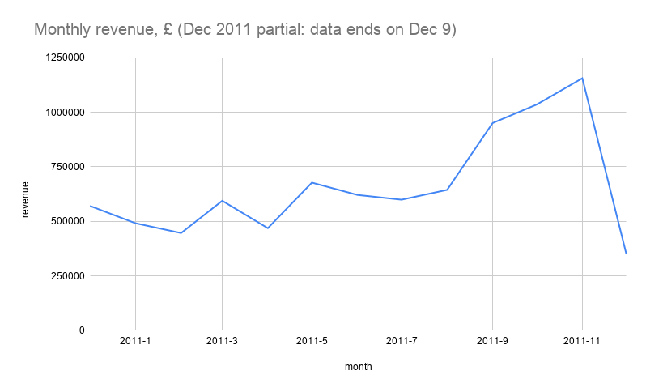
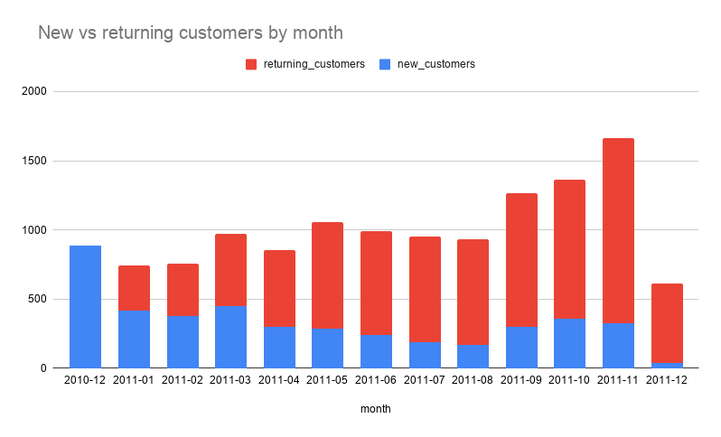
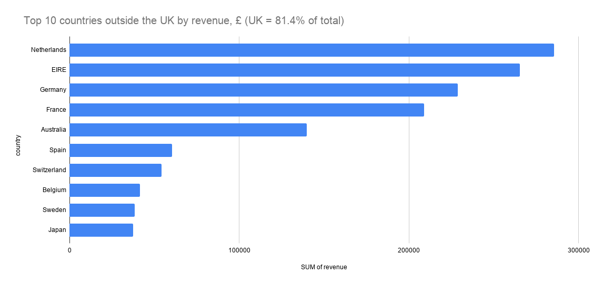
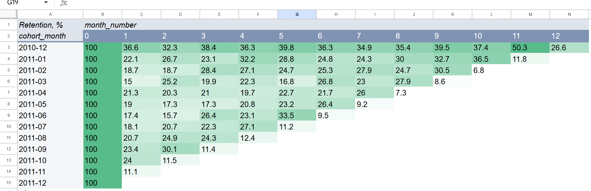

# Online Retail: Sales and Customer Retention Analysis
**Live Google Sheets:** [open the workbook](https://docs.google.com/spreadsheets/d/1pTeOs63BobbryUqvv3pkpvSmGHW-1f_0WFQuF5a2CEg/edit?usp=sharing) (view only)

SQL (SQLite) and Google Sheets analysis of 541,909 transactions from a UK online gift retailer (Dec 2010 – Dec 2011): data cleaning, sales KPIs, new vs returning customers and monthly cohort retention.

## Key results

- **£8.6M revenue** from **18,528 orders** and **4,337 customers** after cleaning. Average order value: **£464**.
- **Seasonal business:** revenue grows from September and peaks in **November 2011 (£1.16M)**, about 2.6× February, the weakest full month.
- **Growth came from more orders, not bigger orders:** in November vs October, orders grew 38% and customers 22%, while the average order value fell 19%.
- **Strong repeat base:** **65.6%** of customers ordered 2 or more times. From July to November 2011, **74–82%** of each month's active customers were returning customers.
- **Cohort retention:** for the January–October 2011 cohorts, 15–24% of new customers bought again in the month after their first purchase. In November 2011, retention went up in 9 of 10 cohorts (seasonal reactivation before Christmas).
- **Revenue concentration:** the UK brings **81.4%** of revenue. Outside the UK, one customer brings 98% of Netherlands revenue (£280K, 3.3% of total revenue).

## Tools

- **Python** (pandas, openpyxl): loading the Excel file into SQLite
- **SQL** (SQLite, DBeaver): cleaning, aggregations, `CASE WHEN`, `JOIN`, CTEs, window functions (`MIN() OVER`, `FIRST_VALUE`)
- **Google Sheets**: pivot tables, `SUMIFS`, `COUNTIFS`, `XLOOKUP`, conditional formatting (heatmap), charts
- **Git / GitHub**

## Data

[UCI Online Retail dataset](https://archive.ics.uci.edu/dataset/352/online+retail) (Chen, 2015, CC BY 4.0): all transactions of a UK-based online retailer selling gift items, from 2010-12-01 to 2011-12-09.

Columns: `InvoiceNo`, `StockCode`, `Description`, `Quantity`, `InvoiceDate`, `UnitPrice`, `CustomerID`, `Country`.

The raw data is not included in this repository (see [How to reproduce](#how-to-reproduce)).

## Project structure

```
online-retail-analysis/
├── load_data.py                  # loads the .xlsx file into SQLite (table raw_transactions)
├── requirements.txt
├── sql/
│   ├── 01_data_check.sql         # first look at the raw data and hypothesis checks
│   ├── 02_cleaning.sql           # cleaning steps -> final table "sales"
│   ├── 03_basic_analysis.sql     # KPIs, monthly report, top products, countries
│   └── 04_customer_analysis.sql  # new vs returning customers, repeat rate, cohorts
├── sheets/
│   └── online_retail_analysis.xlsx
└── images/                       # charts used in this README
```

## Data cleaning

The raw table `raw_transactions` is never modified. All cleaning is done in SQL (`sql/02_cleaning.sql`), which creates the final table `sales`. Each step was counted before deleting:

| Step | Rows removed | Rows remaining |
|---|---:|---:|
| Raw data | – | 541,909 |
| 1. Cancelled invoices (`InvoiceNo` starts with "C") | 9,288 | 532,621 |
| 2. `Quantity <= 0` | 1,336 | 531,285 |
| 3. `UnitPrice <= 0` | 1,181 | 530,104 |
| 4. Missing `CustomerID` | 132,220 | 397,884 |
| 5. Large orders cancelled within minutes | 4 | 397,880 |
| 6. Exact duplicate rows | 5,192 | **392,688** |

Checks behind these steps:

- All 9,288 cancelled rows had a negative quantity. The other 1,336 negative-quantity rows were not cancellations: none of them had a `CustomerID`, and the rows I inspected also had no price and no description, so they look like stock adjustments, not sales.
- When checking the top products, three products looked unrealistic (a huge quantity or a very high price). Each came from an order that the same customer cancelled 3–17 minutes later, for example 80,995 × "PAPER CRAFT, LITTLE BIRDIE". Step 1 removed the cancellation lines but kept the original orders, which added about £285K of revenue that never happened. Step 5 removes these orders.

## Analysis

**Sales** (`sql/03_basic_analysis.sql`)
- Overall KPIs: revenue, orders, customers, average order value (AOV), revenue per customer
- Monthly report: revenue, orders, customers, AOV, revenue per customer
- Top 10 products by revenue (service codes `POST` and `M` excluded). The top 10 products bring only ~7.8% of revenue, so sales are spread across many products.
- Revenue and customers by country

**Customers** (`sql/04_customer_analysis.sql`)
- New customers by month (month of first purchase)
- New vs returning customers by month
- Repeat purchase rate (customers with 2+ orders)
- Cohort retention: share of each first-purchase cohort that bought again 1, 2, 3... months later

**Google Sheets** (`sheets/online_retail_analysis.xlsx`)

| Sheet | Content |
|---|---|
| KPI | key metrics with `SUM`, `COUNTIFS`, `SUMIFS`; customer lookup with `XLOOKUP` |
| customers | one row per customer (exported from SQL) |
| monthly | monthly report; new vs returning customers recalculated with `COUNTIFS` (matches the SQL results); 2 charts |
| countries | pivot table with revenue and customers by country (UK filtered out); chart |
| cohorts, cohort_matrix | cohort data and pivot-table retention matrix with a heatmap |

## Charts









## Limitations

- About 25% of raw transactions had no `CustomerID` and were removed, so total revenue is understated (guest purchases are not included).
- Cancellation lines were removed, but only the largest obvious original orders were matched and removed. Smaller orders that were later cancelled are still counted.
- Exact duplicate rows were treated as data entry errors.
- The data starts on 2010-12-01, so every customer active in December 2010 looks "new", and this cohort includes older loyal customers. The data ends on 2011-12-09, so December 2011 is a partial month.
- A few customers bought from more than one country. The SQL country report uses the country of each transaction, while the `customers` sheet gives each customer one country, so some country numbers differ slightly.
- Revenue = `Quantity × UnitPrice`. There is no data on costs, margins or VAT.

## Metrics in iGaming terms

| This project | iGaming |
|---|---|
| First purchase | First-time deposit (FTD) |
| New customers per month | FTD count per month |
| Returning customers, cohort retention | Player retention by FTD cohort |
| Revenue per customer | ARPU |
| Cancelled orders | Voided bets, refunds |
| Top customers by revenue | VIP / high-value players |

## How to reproduce

1. Download the dataset from UCI and save it as `data/online_retail.xlsx`.
2. Install the libraries: `pip install -r requirements.txt`
3. Run `python load_data.py`. It creates `data/retail.db` with the table `raw_transactions`.
4. Open `data/retail.db` in a SQLite client (for example, DBeaver) and run `sql/02_cleaning.sql`. It creates the table `sales`.
5. Run `sql/03_basic_analysis.sql` and `sql/04_customer_analysis.sql`.
